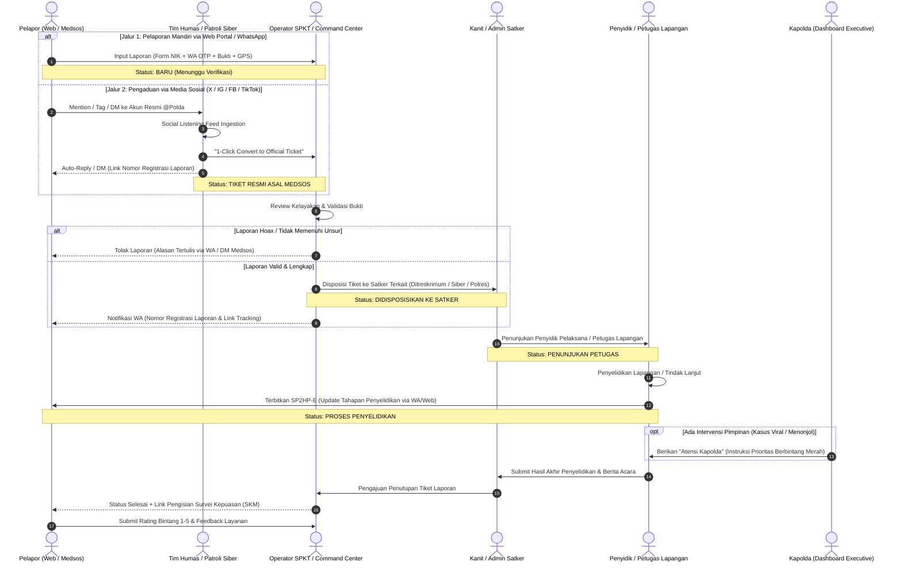

# 📋 PRODUCT REQUIREMENT DOCUMENT (PRD)
## Sistem Informasi & Pengaduan Masyarakat POLDA (SIGAP-POLDA)
### *Edisi Omnichannel & Social Media Ingestion*

---

| Dokumen | Spesifikasi Kebutuhan Produk (PRD) |
| :--- | :--- |
| **Nama Sistem** | **SIGAP-POLDA** (*Sistem Integrasi Pengaduan & Tindak Lanjut Terpadu Polda*) |
| **Versi** | 1.1.0 (Omnichannel & Social Media Extension) |
| **Status** | Approved by Brainstorming / Ready for Implementation |
| **Tech Stack** | PHP Native (MVC), MySQL, Tailwind CSS, Vanilla JS (AJAX), RESTful JSON API |
| **Target Pengguna** | Masyarakat Umum, Petugas SPKT/Command Center, Tim Humas & Patroli Siber, Satker Dit/Polres, Penyidik, Kapolda & PJU |

---

## 1. 🎯 Executive Summary & Latar Belakang

### 1.1 Latar Belakang Masalah
Pelayanan pengaduan masyarakat selama ini kerap menghadapi tantangan:
1. **Laporan Tercecer & Lambat Ditindaklanjuti:** Kurangnya transparansi status perkembangan penanganan perkara kepada pelapor.
2. **Ledakan Aduan di Media Sosial (Kasus Viral):** Tren masyarakat saat ini sangat aktif mengunggah keluhan, tindak pidana, atau pungli melalui media sosial (X/Twitter, Instagram, TikTok, Facebook). Banyak laporan yang tidak terstruktur, viral sebelum ditangani, atau tidak tercatat di register resmi Polda.
3. **Silo Antar Satuan Kerja:** Koordinasi antar Satuan Kerja (Ditreskrimum, Ditreskrimsus/Siber, Ditresnarkoba, Ditlantas, Bidpropam, dan Polres jajaran) sering memakan birokrasi manual yang panjang.
4. **Ketiadaan Visibilitas Pimpinan (Kapolda):** Pimpinan kesulitan memantau peta kerawanan kriminalitas real-time, mengidentifikasi sentimen aduan viral di media sosial, dan memberikan arahan atensi langsung yang terdokumentasi.

### 1.2 Tujuan Produk
Membangun platform terintegrasi satu pintu (*One-Stop Police Service & Omnichannel Case Management System*) yang menjamin:
- **Omnichannel Ingestion:** Menerima laporan dari berbagai pintu: Portal Web Resmi, WhatsApp Gateway, serta **Integrasi Media Sosial (X, Instagram, Facebook, TikTok)**.
- **Transparansi & SP2HP-E:** Pelapor mendapatkan nomor tiket unik dan notifikasi perkembangan perkara secara otomatis melalui WhatsApp & Portal Web.
- **Akuntabilitas:** Alur penanganan perkara terdokumentasi rapi dengan batasan SLA (Service Level Agreement) bertahap.
- **Command & Control Pimpinan:** Dashboard Eksekutif berbasis GIS Heatmap, metrik response time, analisis sentimen medsos, serta fitur intervensi "Atensi Kapolda".

---

## 2. 👥 User Persona & RBAC (Role-Based Access Control)

Sistem mengadopsi 8 tingkatan hak akses berbasis otorisasi ketat:

| No | Role Code | Nama Peran | Hak Akses & Tanggung Jawab Utama |
|---|---|---|---|
| 1 | `ROLE_CITIZEN` | **Pelapor (Masyarakat / Netizen)** | Kirim laporan (Portal Web/WA OTP atau mention/DM Medsos), lacak status tiket, terima SP2HP-E, isi Survei Kepuasan (SKM). |
| 2 | `ROLE_SPKT_OPERATOR` | **Operator SPKT / Command Center** | Triage laporan portal web, verifikasi keabsahan bukti, tolak hoax/spam, disposisi tiket ke Dit/Satker/Polres terkait. |
| 3 | `ROLE_CYBER_HUMAS` | **Operator Medsos (Humas / Siber)** | Memantau feed aduan medsos (*Social Listening Inbox*), validasi mention/DM viral, dan konversi 1-klik ke Tiket Resmi Polda. |
| 4 | `ROLE_SATKER_HEAD` | **Pimpinan Satker / Kapolres** | Monitoring penerimaan disposisi tingkat direktorat/polres, menyetujui penghentian perkara/penutupan tiket, supervisi. |
| 5 | `ROLE_SATKER_ADMIN` | **Admin / Kanit Satker** | Menerima tiket dari SPKT/Medsos, menunjuk Penyidik / Tim Petugas Lapangan penanggung jawab kasus. |
| 6 | `ROLE_INVESTIGATOR` | **Penyidik / Petugas Lapangan** | Menangani penyelidikan, input Berita Acara, unggah bukti penanganan, terbitkan SP2HP Elektronik ke pelapor. |
| 7 | `ROLE_INTERNAL_AFFAIRS` | **Pengawas (Irwasda / Bidpropam)** | Audit trail independen terhadap kepatuhan penanganan, investigasi aduan dumas terkait perilaku personil. |
| 8 | `ROLE_EXECUTIVE` | **Executive (Kapolda / Wakapolda)** | Dashboard eksekutif komprehensif, GIS crime heatmap, SLA monitoring, monitor kasus viral medsos, tombol *Atensi Kapolda*. |
| 9 | `ROLE_SUPERADMIN` | **Superadmin IT Polda** | Konfigurasi sistem, master data satker & polres, user management, konfigurasi API/Webhook Medsos & WA Gateway. |

---

## 3. 🔄 End-to-End Business Process & Workflow Penanganan (Omnichannel)



---

## 4. 🧩 Modul Fungsional Utama

### 4.1 Modul Publik (Citizen Portal)
1. **Pendaftaran & Autentikasi Pelapor:**
   - Input NIK KTP (16 digit), Nama Sesuai KTP, Nomor WhatsApp Aktif.
   - Verifikasi 6-digit OTP melalui WhatsApp Gateway.
   - Proteksi Opsi *Whistleblower*: Centang `"Rahasiakan Identitas Saya"` (Data pribadi disamarkan dari terlapor/publik dan hanya bisa diakses oleh level Kanit/Dir untuk keperluan Berita Acara).
2. **Formulir Pengaduan Cerdas (Smart Report Form):**
   - Kategori Aduan: Kriminal Umum (Curat/Curas/Curanmor/Penipuan), Kriminal Khusus/Cyber, Narkotika, Lalu Lintas, Perilaku Personil (Propam), Kedaruratan/Keamanan.
   - Waktu & Tempat Kejadian Perkara (TKP) dengan integrasi Google Maps / Leaflet (Penandaan Koordinat Lat/Long akurat).
   - Multi-upload Bukti Digital: Foto TKP, Dokumen PDF, Video (Maksimal ukuran terkompresi).
3. **Portal Pelacakan Tiket (Live Ticket Tracker):**
   - Halaman tracking publik dengan input Nomor Tiket Unik + PIN Keamanan Laporan.
   - Visualisasi Timeline Milestone penanganan (Verifikasi -> Disposisi -> Penyelidikan -> Selesai).
   - Akses Download SP2HP-E dalam format dokumen PDF resmi ber-watermark QR Code keabsahan.
4. **Survei Kepuasan Masyarakat (SKM):**
   - Form rating bintang 1–5, aspek kecepatan respon, keramahan petugas, dan kejelasan informasi tindak lanjut.

### 4.2 Modul Pengaduan Media Sosial (Omnichannel Social Media Ingestion)
1. **Social Listening & Webhook Listener:**
   - Mengambil mention, komentar, hashtag aduan khusus (misal: `#LaporPolda`, `@HumasPolda`), dan Direct Messages (DM) dari:
     - **X (Twitter):** Mentions, Quote Tweets, dan DM akun resmi.
     - **Instagram:** Direct Messages & Tagged Comments.
     - **Facebook:** Page Inbox & Post Mentions.
     - **TikTok:** Mention & Tag aduan video publik.
2. **Social Media Triage Inbox (Workspace Humas & Siber):**
   - Panel antrean khusus berisi postingan masuk lengkap dengan avatar, username, teks keluhan, tautan URL asli, dan bukti foto/video.
   - Filter pintar: Sentimen analitik sederhana (Negatif/Urgen, Netral, Spam).
3. **Fitur "1-Click Convert to Official Ticket":**
   - Petugas Humas/Siber dapat langsung menekan tombol `"Jadikan Tiket Resmi"`.
   - Sistem otomatis membuat draf laporan bernomor tiket `LP-POLDA-MEDSOS-XXXX`, mengekstrak bukti lampiran media, dan memetakan platform asalnya.
4. **Social Bot Auto-Responder:**
   - Setelah tiket dikonversi, sistem otomatis mengirimkan balasan (Reply/DM) ke pengunggah di media sosial:
     > *"Halo @username, laporan Anda telah kami teruskan ke sistem resmi SIGAP Polda dengan No Tiket #LP-POLDA-XXXX. Silakan pantau perkembangan tindak lanjut atau lengkapi identitas Anda di: https://sigap.polda.go.id/track?id=..."*

### 4.3 Modul Command Center / Backoffice SPKT Polda
1. **Queue Verifikasi & Triage:**
   - Antrean laporan masuk real-time (baik dari Web Portal, WhatsApp, maupun Eskalasi Medsos).
   - Indikator asal kanal (*Channel Badge*: Web, WA, Twitter, IG, FB, TikTok).
   - Fitur Quick Action: Terima & Disposisikan, Minta Lengkapi Bukti, atau Tolak (dengan alasan jelas).
2. **Mesin Disposisi:**
   - Dropdown cerdas pemetaan kewenangan: Satuan Kerja Direktorat Polda vs Satuan Reskrim/Lantas/Narkoba Polres jajaran sesuai lokus TKP.

### 4.4 Modul Backoffice Penyelidikan Satker / Polres
1. **Manajemen Disposisi Masuk:**
   - Kanit/Kasatker menerima notifikasi disposisi dan menetapkan Surat Perintah Penugasan Petugas (Sprintgas) ke Penyidik.
2. **Workspace Penyidik (Investigator Workspace):**
   - Catatan Penyelidikan Terpisah:
     - *Catatan Internal:* Rahasia penyelidikan polisi (hanya terlihat oleh tim satker, pimpinan, dan Irwasda).
     - *Update Publik (SP2HP-E):* Keterangan resmi yang akan terkirim ke pelapor.
   - Generator SP2HP Digital: Sistem menyusun draf format standar SP2HP (A1, A2, dst.) yang langsung ditandatangani digital oleh Penyidik & Kanit.
3. **SLA Monitoring Alert:**
   - Indikator waktu mundur penanganan (SLA 3x24 jam untuk respon awal, 14 hari untuk update SP2HP lanjutan).
   - Badge warna peringatan: Hijau (Aman), Kuning (Mendekati Tenggat), Merah (Overdue).

### 4.5 Modul Dashboard Executive (Khusus Kapolda & PJU)
1. **GIS Heatmap Kriminalitas & Gangguan Kamtibmas:**
   - Peta spasial interaktif wilayah hukum Polda dengan layer klaster titik kejadian berdasarkan kategori perkara dan filter rentang tanggal.
   - Drill-down per wilayah hukum Polres dan Polsek.
2. **Social Media Crisis & Viral Case Radar:**
   - Widget pantauan isu viral media sosial dengan tren engagement tertinggi.
   - Filter khusus: *"Tampilkan Kasus Berasal dari Media Sosial"*.
3. **Executive KPI Cards:**
   - Total Laporan Masuk vs Terselesaikan (*Crime Clearance Rate* %).
   - Rasio Penyelesaian Kasus Berdasarkan Kanal (Web vs WA vs Medsos).
   - Rata-rata Waktu Tanggap (*Mean Response Time*) dari Laporan Masuk hingga Aksi Lapangan.
   - Peringkat Satker/Polres dengan SLA Kinerja Terbaik dan Terendah (*Bottleneck Watchlist*).
   - Indeks Kepuasan Masyarakat (IKM) kumulatif Polda.
4. **Fitur "Atensi Kapolda" (Direct Directive Intervention):**
   - Kapolda dapat memilih laporan perkara tertentu (misal kasus viral atau menonjol) dan mengklik tombol `"Beri Atensi Kapolda"`.
   - Sistem membubuhkan tanda Bintang Merah (*Kapolda's Priority Flag*).
   - Menghasilkan notifikasi instan berprioritas tertinggi langsung ke ponsel Kasatker/Kapolres terkait dengan tenggat waktu respon 1x24 jam.

---

## 5. 🏗️ Arsitektur Teknis (PHP Native MVC & Tailwind)

### 5.1 Struktur Direktori Proyek
Sesuai instruksi teknis tanpa framework, arsitektur menerapkan pola MVC yang rapi, modular, dan terstruktur:

```
SIGAP-Polda/
│
├── app/
│   ├── config/
│   │   ├── Database.php            # Koneksi PDO MySQL aman (Prepared Statements)
│   │   ├── Config.php              # Konstanta Aplikasi, Base URL, Credentials
│   │   └── Constants.php           # Status Code, Enums Kategori, Roles, Channels
│   │
│   ├── core/
│   │   ├── App.php                 # Front-Controller & URL Routing Engine
│   │   ├── Controller.php          # Base Controller (render view, json response)
│   │   ├── Model.php               # Base Model (Query Builder helper)
│   │   ├── Session.php             # Session Manager aman (CSRF, Anti-Hijacking)
│   │   └── Auth.php                # Middleware RBAC & Guard Helper
│   │
│   ├── controllers/
│   │   ├── HomeController.php       # Landing Page & Portal Publik
│   │   ├── AuthController.php       # Login Backoffice & OTP Pelapor
│   │   ├── ReportController.php     # Submission Laporan & Tracking Pelapor
│   │   ├── SocialMediaController.php # Ingestion & Triage Medsos (Humas/Siber)
│   │   ├── SpktController.php       # Triage & Disposisi SPKT
│   │   ├── SatkerController.php     # Assignment & Case Management Satker
│   │   ├── InvestigatorController.php # Penanganan & SP2HP-E
│   │   ├── ExecutiveController.php  # Dashboard Executive Kapolda, Heatmap & Medsos Radar
│   │   └── ApiController.php        # RESTful JSON Endpoints & Webhooks Medsos
│   │
│   ├── models/
│   │   ├── User.php
│   │   ├── Report.php
│   │   ├── SocialFeed.php          # Data Mentions, DM, Post Medsos
│   │   ├── ReportProgress.php      # SP2HP & Timeline History
│   │   ├── Attachment.php          # File Bukti & Dokumen
│   │   ├── Satker.php              # Master Data Dit / Polres / Polsek
│   │   ├── Directive.php           # Atensi Kapolda
│   │   └── Feedback.php           # Survei Kepuasan (SKM)
│   │
│   └── views/
│       ├── layouts/
│       │   ├── main.php            # Master Layout Publik
│       │   ├── admin.php           # Master Layout Backoffice
│       │   └── executive.php       # Master Layout Khusus Kapolda
│       ├── public/
│       │   ├── index.php           # Landing Page Elegan
│       │   ├── create_report.php   # Form Multi-step Pengaduan
│       │   └── track.php           # Halaman Cek Status & SP2HP
│       ├── backoffice/
│       │   ├── social_triage.php   # Inbox Antrean Aduan Media Sosial
│       │   ├── spkt_triage.php     # Meja Verifikasi Operator
│       │   ├── satker_inbox.php    # Inbox Satker & Penugasan
│       │   └── case_detail.php     # Detail Penyelidikan & Form SP2HP
│       └── executive/
│           ├── dashboard.php       # Dashboard Kapolda, Heatmap & Radar Medsos
│           └── directive_modal.php # Modal Atensi Kapolda
│
├── public/
│   ├── index.php                   # Single Entrypoint Web Server
│   ├── .htaccess                   # Rewrite Engine ke index.php
│   ├── assets/
│   │   ├── css/                    # Tailwind CSS output / Tailwind CDN
│   │   ├── js/
│   │   │   ├── app.js              # Core JS Utilities & Toast Handler
│   │   │   ├── report_form.js      # AJAX Submission & Multi-step Logic
│   │   │   ├── social_inbox.js     # AJAX Triage & Quick Convert Tiket Medsos
│   │   │   ├── gis_heatmap.js      # Leaflet.js Peta Sebaran Kriminalitas
│   │   │   └── executive_chart.js  # Chart.js KPI & Sentiment Visualizations
│   │   └── img/                    # Lambang Polri, Presisi, Mock Assets
│   └── uploads/                    # Direktori Bukti Laporan & Dokumen BAP
│
└── database/
    └── schema.sql                  # DDL Skema MySQL Lengkap
```

---

## 6. 🗄️ Desain Skema Database (MySQL Relational Schema)

### 6.1 Tabel Utama & Hubungan Relasi
1. `users`: Menyimpan data akun Backoffice (Polri) & Akun Warga Pelapor.
   - `id`, `nik`, `name`, `email`, `phone`, `password_hash`, `role` (ENUM), `satker_id`, `created_at`.
2. `satkers`: Master Satuan Kerja Direktorat & Polres jajaran.
   - `id`, `parent_id`, `type` (Polda/Dit/Polres/Polsek), `code`, `name`, `latitude`, `longitude`.
3. `social_feeds`: Data antrean mention / direct messages dari media sosial sebelum jadi tiket.
   - `id`, `platform` (`TWITTER_X`, `INSTAGRAM`, `FACEBOOK`, `TIKTOK`),
   - `post_id_str` (ID unik postingan dari platform),
   - `author_username`, `author_name`, `post_content`, `post_url`,
   - `media_urls` (JSON array link gambar/video),
   - `sentiment` (`NEGATIVE_URGENT`, `NEUTRAL`, `POSITIVE`, `SPAM`),
   - `status` (`NEW`, `CONVERTED_TO_TICKET`, `DISMISSED_SPAM`),
   - `converted_report_id` (FK nullable ke `reports.id`),
   - `handled_by_user_id` (FK ke `users.id`),
   - `created_at`.
4. `reports`: Data induk pengaduan masyarakat (Multi-channel).
   - `id`, `ticket_number` (Unique, cth: `LP-POLDA-202610-0012`),
   - `source_channel` (`WEB_PORTAL`, `WHATSAPP_BOT`, `TWITTER_X`, `INSTAGRAM`, `FACEBOOK`, `TIKTOK`, `CALL_CENTER_110`),
   - `social_feed_id` (FK nullable ke `social_feeds.id`),
   - `social_post_url` (VARCHAR nullable),
   - `reporter_id` (FK nullable ke `users.id`),
   - `is_anonymous` (TINYINT),
   - `category_id`, `title`, `description`, `incident_date`, `incident_location`, `latitude`, `longitude`,
   - `current_satker_id`, `assigned_investigator_id`,
   - `status` (`DRAFT`, `SUBMITTED`, `VERIFIED_SPKT`, `DISPATCHED`, `ASSIGNED`, `INVESTIGATING`, `CLOSED`, `REJECTED`),
   - `urgency_level` (`NORMAL`, `HIGH`, `EMERGENCY`),
   - `is_kapolda_attention` (TINYINT default 0),
   - `sla_deadline` (DATETIME), `created_at`, `updated_at`.
5. `report_attachments`: File bukti pengaduan pelapor dan lampiran penyelidikan.
   - `id`, `report_id`, `uploader_id`, `file_type`, `file_path`, `caption`, `created_at`.
6. `report_timeline`: Riwayat status, disposisi, dan SP2HP Elektronik.
   - `id`, `report_id`, `actor_id`, `status_from`, `status_to`, `title`, `public_notes` (dikirim ke pelapor), `internal_notes` (rahasia dinas), `created_at`.
7. `kapolda_directives`: Catatan instruksi langsung Kapolda untuk laporan khusus.
   - `id`, `report_id`, `created_by` (Kapolda), `directive_text`, `target_satker_id`, `status` (`PENDING`, `ACKNOWLEDGED`, `RESOLVED`), `created_at`.
8. `report_feedbacks`: Survei Kepuasan Masyarakat (SKM) setelah tiket selesai.
   - `id`, `report_id`, `rating_stars` (1-5), `speed_score`, `fairness_score`, `comments`, `created_at`.

---

## 7. 🔒 Standar Keamanan & RBAC Enforcement

1. **Prepared Statements Penuh (PDO):** Menjamin 100% proteksi terhadap SQL Injection pada seluruh query data.
2. **Session Security:**
   - Regenerasi ID session berkala (`session_regenerate_id(true)`).
   - Pengikatan session terhadap User-Agent dan IP Address untuk mencegah *Session Hijacking*.
   - Cookie HTTPOnly, Secure, dan SameSite=Strict.
3. **Webhook Security:** Verifikasi signature HMAC SHA-256 pada setiap payload webhook dari API Media Sosial dan WhatsApp Gateway untuk mencegah request spoofing.
4. **CSRF Protection:** Setiap request POST/PUT/DELETE wajib menyertakan token CSRF unik yang divalidasi oleh Core Controller.
5. **Data Privacy & Whistleblower Sanitization:** Jika `is_anonymous = 1`, query API publik dan query level petugas operasional lapangan wajib menyamarkan field NIK dan Nama lengkap pelapor (misal: `J*** D**`).
6. **Role Middleware Interceptor:** Setiap routing ke controller diproteksi pemetaan role:
   - Route `/executive/*` -> Wajib `ROLE_EXECUTIVE` atau `ROLE_SUPERADMIN`.
   - Route `/social/*` -> Wajib `ROLE_CYBER_HUMAS`, `ROLE_SPKT_OPERATOR`, atau `ROLE_SUPERADMIN`.
   - Route `/spkt/*` -> Wajib `ROLE_SPKT_OPERATOR` atau `ROLE_SUPERADMIN`.
   - Route `/satker/*` -> Wajib `ROLE_SATKER_HEAD`, `ROLE_SATKER_ADMIN`, atau `ROLE_INVESTIGATOR`.

---

## 8. 🎨 Desain Antarmuka & UX (Tailwind Premium)

1. **Nuansa Visual Polri Modern:**
   - Palet Warna: *Navy Blue Polri* (`#0A192F`, `#1E3A8A`), *Golden Brass Accents* (`#D97706`, `#F59E0B`), Slate Gray background bersih dengan dukungan Dark Mode untuk Command Center.
2. **Social Media Triage Inbox UX:**
   - Kartu tweet/post interaktif dengan warna badge khas platform (Biru X/Twitter, Gradien Pink IG, Biru FB, Hitam TikTok).
   - Tombol cepat: *"1-Click Buat Tiket"* dan preview media langsung di dalam browser tanpa perlu pindah tab.
3. **Executive Dashboard Kapolda UX:**
   - Layar penuh (*Full-screen Command Center View*) tanpa distraksi navigasi berbelit.
   - Kartu Metrik dengan *Glassmorphism effect* dan *glowing indicators* untuk status darurat/atensi.
   - Panel Peta GIS interaktif terintegrasi dengan filter dinamis 1-klik (Semua Kasus, Kasus Menunggak SLA, Kasus Atensi Kapolda, Kasus Viral Medsos).
4. **Portal Publik Mobile-First:**
   - Desain intuitif ramah gawai untuk warga masyarakat dari segala kalangan usia.
   - Multi-step form interaktif dengan progress bar yang jelas saat melampirkan berkas bukti.

---

## 9. 🚀 Roadmap Implementasi & Milestone Pengembangan

```
Phase 1: Pondasi & Setup Core Framework (PHP Native MVC, DB, Auth & RBAC)
└── Minggu 1: Setup Routing, PDO Wrapper, Session RBAC, Migration Skema DB.

Phase 2: Portal Pengaduan Masyarakat & Tracking Publik
└── Minggu 2: Form Laporan Warga, WhatsApp OTP Integration, Upload Bukti, Halaman Tracking.

Phase 3: Backoffice SPKT, Modul Medsos (Social Ingestion) & Satker Workflow
└── Minggu 3: Dashboard Triage SPKT, Social Ingestion Inbox (Humas/Siber), Modul Disposisi Satker, Modul SP2HP-E.

Phase 4: Dashboard Executive Kapolda, Radar Medsos & GIS Heatmap
└── Minggu 4: Integrasi Leaflet/GIS Heatmap, Radar Kasus Viral Medsos, Metrik SLA Bottleneck, Tombol Atensi Kapolda.

Phase 5: Notifikasi WhatsApp Gateway, Webhook Testing, & Finalisasi
└── Minggu 5: Webhook Notifikasi, Auto-DM Medsos, End-to-End Testing, Security Hardening, & Deployment.
```

---
*Dokumen ini merupakan acuan resmi pengembangan aplikasi SIGAP-Polda. Setiap implementasi kode wajib mengacu pada spesifikasi arsitektur dan aturan RBAC di atas.*
