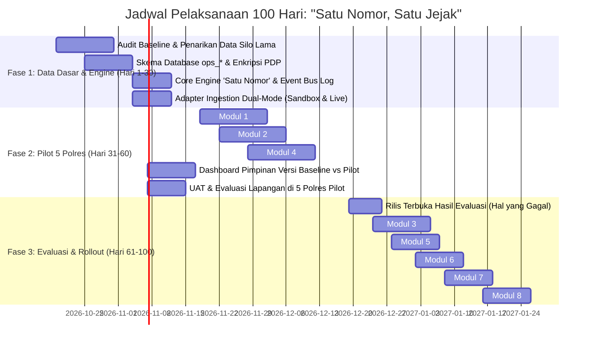

# 🗺️ ROADMAP: “SATU NOMOR, SATU JEJAK” (ONE POLICE SERVICE) v1.3
### *Integrasi Layanan Terpadu, Event Bus & Dashboard Akuntabilitas 100 Hari Polri Presisi*

> **Prinsip Utama:**  
> *"Struktur internal Polri bukan beban masyarakat — Satu nomor pelacakan hidup dari panggilan pertama hingga putusan berkekuatan hukum tetap."* (Program Prioritas Kapolri 3.4 & Commander's Wish)

---

## 📑 Daftar Isi
1. [Latar Belakang & Filosofi Arsitektur](#1-latar-belakang--filosofi-arsitektur)
2. [Arsitektur 5-Layer Sistem](#2-arsitektur-5-layer-sistem)
3. [Standar Penomoran Global: "Satu Nomor, Satu Jejak"](#3-standar-penomoran-global-satu-nomor-satu-jejak)
4. [Skema Data Terpadu (`ops_*`)](#4-skema-data-terpadu-ops_)
5. [Rincian 8 Modul Quick Win & Program Prioritas](#5-rincian-8-modul-quick-win--program-prioritas)
6. [Mekanisme Event Bus & Dual-Mode Adapter](#6-mekanisme-event-bus--dual-mode-adapter)
7. [Tata Kelola Keamanan & Kepatuhan UU PDP](#7-tata-kelola-keamanan--kepatuhan-uu-pdp)
8. [Dashboard Akuntabilitas 100 Hari (Menjawab Hal. 41)](#8-dashboard-akuntabilitas-100-hari-menjawab-hal-41)
9. [Roadmap Taktis 100 Hari (3 Fase Pelaksanaan)](#9-roadmap-taktis-100-hari-3-fase-pelaksanaan)
10. [Konvensi Teknis & Standar Kualitas](#10-konvensi-teknis--standar-kualitas)

---

## 1. Latar Belakang & Filosofi Arsitektur

Saat ini, warga yang berurusan dengan kepolisian kerap dihadapkan pada fragmentasi sistem: melapor ke **110** mendapat nomor antrean panggilan; datang ke **SPKT** menerima tanda bukti lapor (STPL); penyidikan berjalan di **e-MP** dengan register perkara terpisah; jika ada komplain ke **Dumas Presisi/Propam** mendapat nomor register lain lagi. Fragmentasi ini memaksa warga memahami struktur birokrasi internal Polri.

**Versi 1.3 "Satu Nomor, Satu Jejak"** hadir sebagai lapisan integrasi (*Integration & Event Bus Layer*) di atas ekosistem **SIGAP-POLDA**:
* **Integrasi, bukan penggantian:** Tidak menghapus atau membangun ulang dari nol sistem yang telah ada (Dumas Presisi, e-MP, SP2HP Online, ETLE, Polri Super App), melainkan menempatkan lapisan adaptif di atasnya.
* **Ukur hasil (outcome), bukan kegiatan seremonial:** Mengakhiri pelaporan semu berbasis kuantitas kegiatan (misal: "telah melaksanakan 26.000 kegiatan sambang"), beralih ke metrik kinerja riil: kecepatan respons, kepatuhan batas waktu SP2HP, penuntasan perkara, dan pemulihan kerugian korban.
* **Kanal tatap muka inklusif:** Menyediakan fitur *Proxy Entry* di SPKT untuk melayani warga rentan/gaptek yang tetap terhubung ke ekosistem pelacakan digital via SMS resmi.

---

## 2. Arsitektur 5-Layer Sistem

Sistem dirancang dalam 5 lapisan modular dengan pemisahan tanggung jawab yang tegas:

```
[ LAYER 1: OMNICHANNEL INGESTION ]
├── Panggilan 110 (Telepon Suara / CAD)
├── Loket SPKT (Tatap Muka / Proxy Entry Petugas)
├── Portal Web SIGAP (Lapor & Lacak Mandiri)
└── Super App Polri / WhatsApp Bot / Medsos

                 │
                 ▼
[ LAYER 2: GATEWAY, IDENTITAS & SECURITY ]
├── Single Sign-On (SSO Presisi)
├── Generator "Satu Nomor Lacak Global"
├── RBAC 12 Level & Yurisdiksi Satker
├── Enkripsi Data Pribadi (UU PDP: AES-256)
└── Dual-Control Audit Trail Logger

                 │
                 ▼
[ LAYER 3: DOMAIN WORKSPACE MODUL ]
├── Modul 1: Pelacak Layanan & SP2HP Otomatis
├── Modul 2: Triase & Dispatch 110 (CAD Geolocation)
├── Modul 3: Penerimaan SPKT Ramah Korban (PPA & No Rejection)
├── Modul 4: Manajemen Perkara (Case Management & e-MP)
├── Modul 5: Dumas Terpadu & Peringatan Dini Integritas
├── Modul 6: Aduan Siber & CekRekening (Blokir Cepat OJK/Bank)
└── Modul 7: Peta Kerawanan & Catatan Solusi Bhabinkamtibmas

                 │
                 ▼
[ LAYER 4: ASYNCHRONOUS EVENT BUS ]
└── Transactional Outbox Pattern (`ops_event_streams`)
    Setiap status berganti = Terbit 1 Immutable Event (Pub/Sub)

                 │
                 ▼
[ LAYER 5: SATU DATA POLRI & ANALYTICS ]
├── Master Data & Data Warehouse Terpadu (`ops_master_*`)
└── Dashboard Akuntabilitas 100 Hari (Executive & Public Mode)
```

---

## 3. Standar Penomoran Global: "Satu Nomor, Satu Jejak"

Setiap interaksi pertama warga langsung melahirkan satu pengenal unik global (**Global Case Identifier**):

$$\mathbf{POL - [TAHUN][BULAN] - [KODE\_KANAL] - [RANDOM\_ALPHANUMERC\_5]}$$

### Contoh Penomoran:
* `POL-202610-110-8924A` : Bermula dari panggilan darurat 110.
* `POL-202610-SPKT-7712B` : Bermula dari laporan fisik di loket SPKT.
* `POL-202610-WEB-4102C` : Bermula dari portal mandiri warga.
* `POL-202610-CYB-3310D` : Bermula dari aduan penipuan daring (Ditreskrimsiber).
* `POL-202610-DMS-1049E` : Bermula dari aduan perilaku anggota (Propam/WBS).

### Prinsip Siklus Hidup:
1. **Tidak Berganti:** Ketika panggilan darurat 110 dieskalasikan menjadi Laporan Polisi (LP) di SPKT dan dilanjutkan ke penyidikan Satreskrim, **nomor lacak warga tidak pernah berubah**.
2. **Keterkaitan Data (*Data Binding*):** Berkas e-MP, surat penugasan Sprintgas, nomor SP2HP (A1–A5), hingga registrasi barang bukti ditautkan sebagai *child records* dari nomor global ini.
3. **Akses Warga Tanpa Sandi Rumit:** Pelapor cukup memasukkan Nomor Pelacakan + PIN Keamanan 6-Digit (dikirim via SMS/WA resmi) untuk memantau status secara *real-time*.

---

## 4. Skema Data Terpadu (`ops_*`)

Untuk menjaga stabilitas tabel `reports` dan modul Posko yang sudah berjalan, seluruh entitas integrasi menggunakan namespace `App\Models\OneService\*` dan tabel berawalan `ops_`:

### 4.1. Tabel `ops_global_tracks` (Induk Jejak Kasus)
```sql
CREATE TABLE IF NOT EXISTS `ops_global_tracks` (
    `id` BIGINT AUTO_INCREMENT PRIMARY KEY,
    `tracking_number` VARCHAR(50) NOT NULL UNIQUE COMMENT 'POL-YYYYMM-KANAL-XXXXX',
    `security_pin_hash` VARCHAR(255) NOT NULL,
    `source_channel` ENUM('110_CALL', 'SPKT_LOKET', 'WEB_PORTAL', 'SUPERAPP', 'DUMAS_PROPAM', 'CYBER_CRIME') NOT NULL,
    `current_status` ENUM('INCOMING', 'DISPATCHED', 'VERIFIED_SPKT', 'INVESTIGATION', 'RESOLVED', 'CLOSED', 'REJECTED') NOT NULL DEFAULT 'INCOMING',
    `priority_level` ENUM('P1_EMERGENCY', 'P2_URGENT', 'P3_ROUTINE') NOT NULL DEFAULT 'P3_ROUTINE',
    `incident_category` VARCHAR(100) NOT NULL,
    `incident_summary` TEXT NOT NULL,
    `incident_lat` DECIMAL(10, 8) NULL,
    `incident_lng` DECIMAL(11, 8) NULL,
    `incident_address` TEXT NULL,
    `citizen_name` VARCHAR(150) NOT NULL,
    `citizen_nik_encrypted` VARBINARY(256) NULL COMMENT 'Enkripsi AES-256 (UU PDP)',
    `citizen_phone` VARCHAR(30) NOT NULL,
    `is_whistleblower` TINYINT(1) NOT NULL DEFAULT 0,
    `current_satker_id` INT NOT NULL,
    `assigned_officer_nrp` VARCHAR(50) NULL,
    `external_reference_no` VARCHAR(100) NULL COMMENT 'Nomor LP e-MP / ID Tiket 110 Lama / No Dumas Presisi',
    `sla_deadline` DATETIME NULL,
    `is_stalled` TINYINT(1) NOT NULL DEFAULT 0 COMMENT '1: Terdeteksi mangkrak / melewati SLA',
    `created_at` TIMESTAMP DEFAULT CURRENT_TIMESTAMP,
    `updated_at` TIMESTAMP DEFAULT CURRENT_TIMESTAMP ON UPDATE CURRENT_TIMESTAMP,
    INDEX `idx_ops_track` (`tracking_number`),
    INDEX `idx_ops_status_satker` (`current_status`, `current_satker_id`),
    INDEX `idx_ops_sla` (`sla_deadline`, `is_stalled`)
) ENGINE=InnoDB DEFAULT CHARSET=utf8mb4;
```

### 4.2. Tabel `ops_event_streams` (Event Bus Log)
```sql
CREATE TABLE IF NOT EXISTS `ops_event_streams` (
    `id` BIGINT AUTO_INCREMENT PRIMARY KEY,
    `tracking_number` VARCHAR(50) NOT NULL,
    `event_name` VARCHAR(100) NOT NULL COMMENT 'e.g. 110_DISPATCHED, SPKT_ACCEPTED, SP2HP_ISSUED, DUMAS_FLAGGED',
    `payload_data` JSON NOT NULL,
    `actor_nrp_or_system` VARCHAR(50) NOT NULL,
    `actor_role` VARCHAR(50) NOT NULL,
    `ip_address` VARCHAR(45) NOT NULL,
    `created_at` TIMESTAMP DEFAULT CURRENT_TIMESTAMP,
    INDEX `idx_event_track` (`tracking_number`),
    INDEX `idx_event_name_created` (`event_name`, `created_at`)
) ENGINE=InnoDB DEFAULT CHARSET=utf8mb4;
```

### 4.3. Tabel `ops_audit_pdp_logs` (Audit Log Kepatuhan UU PDP)
```sql
CREATE TABLE IF NOT EXISTS `ops_audit_pdp_logs` (
    `id` BIGINT AUTO_INCREMENT PRIMARY KEY,
    `tracking_number` VARCHAR(50) NOT NULL,
    `viewer_nrp` VARCHAR(50) NOT NULL,
    `viewer_satker_id` INT NOT NULL,
    `accessed_data` VARCHAR(255) NOT NULL COMMENT 'NIK, NAMA_KORBAN, HP, BUKTI_SENSITIF',
    `justification` VARCHAR(255) NOT NULL COMMENT 'Alasan dinas membuka data pribadi',
    `is_out_of_jurisdiction` TINYINT(1) NOT NULL DEFAULT 0,
    `ip_address` VARCHAR(45) NOT NULL,
    `user_agent` TEXT NULL,
    `accessed_at` TIMESTAMP DEFAULT CURRENT_TIMESTAMP,
    INDEX `idx_pdp_viewer` (`viewer_nrp`),
    INDEX `idx_pdp_track` (`tracking_number`)
) ENGINE=InnoDB DEFAULT CHARSET=utf8mb4;
```

---

## 5. Rincian 8 Modul Quick Win & Program Prioritas

### Modul 1: Pelacak Layanan & SP2HP Otomatis
* **Fungsi:** Pelacakan publik status laporan, trigger otomatis penerbitan SP2HP (A1 format penerimaan laporan, A2 perkembangan penyelidikan, A3 peningkatan ke penyidikan, A4 pengiriman berkas ke JPU, A5 penghentian/penyelesaian).
* **Fitur Utama:**
  * SLA Countdown per tahap perkara (misal batas SP2HP A2 = 14 hari).
  * *Watchdog Alert*: Pengingat otomatis H-3 kepada penyidik via sistem; jika lewat tenggat, otomatis berstatus *STALLED* dan melapor ke dashboard pimpinan.
  * Unduh resmi SP2HP elektronik terverifikasi QR Code anti-pemalsuan.

### Modul 2: Triase & Dispatch 110 (Computer-Aided Dispatch)
* **Fungsi:** Penerimaan panggilan darurat, klasifikasi urgensi (P1/P2/P3), penentuan unit patroli Samapta/Lantas terdekat berbasis radius GPS.
* **Fitur Utama:**
  * Konsol Operator 110 dengan tombol cepat *One-Click Dispatch*.
  * Pelacak waktu respons: *Time to Dispatch* (target < 2 menit) dan *Time to Arrive at Scene* (target < 10–15 menit).
  * Tombol integrasi: Eskalasi otomatis ke Laporan Polisi (LP) di SPKT tanpa mengulang ketik data korban.

### Modul 3: Penerimaan SPKT Ramah Korban
* **Fungsi:** Pintu gerbang pelaporan fisik dengan standar operasional *Zero Rejection* (dilarang menolak laporan warga).
* **Fitur Utama:**
  * Alur Rujukan Otomatis: Jika perkara di luar ranah/yurisdiksi, sistem memfasilitasi disposisi antar-satker tanpa warga disuruh pulang.
  * Formulir Jalur Khusus Perlindungan Perempuan dan Anak (PPA) serta Difabel.
  * Fitur *Proxy Entry*: Petugas SPKT menginput atas nama warga, nomor lacak dikirimkan langsung ke nomor SMS warga di tempat.

### Modul 4: Manajemen Perkara (Case Management)
* **Fungsi:** Lembar kerja penyidik, pengelolaan timeline perkara, koordinasi pra-penuntutan bersama Kejaksaan (JPU).
* **Fitur Utama:**
  * Digital Chain of Custody: Katalogisasi barang bukti fisik dan digital disertai hash kriptografi SHA-256.
  * Deteksi Otomatis Perkara Beku: Kasus tanpa aktivitas penyidikan > 30 hari otomatis masuk daftar antrean *Gelar Perkara Khusus*.
  * Integrasi data berkas tahap 1, P-18/P-19, dan P-21.

### Modul 5: Dumas Terpadu & Peringatan Dini Integritas
* **Fungsi:** Satu pintu penanganan aduan masyarakat terkait perilaku personel (Dumas Presisi, Propam, WBS).
* **Fitur Utama:**
  * Mode Kerahasiaan Whistleblower: Identitas pelapor dienkripsi penuh di tingkat basis data.
  * *Early Warning Anomaly Detection*: Algoritma mendeteksi lonjakan aduan pungli atau pemerasan pada satuan kerja/loket tertentu dalam kurun waktu 14 hari.

### Modul 6: Aduan Penipuan Daring & Blokir Cepat
* **Fungsi:** Penanganan kejahatan siber finansial dan penipuan daring secara cepat (*Fast-Action Anti-Fraud*).
* **Fitur Utama:**
  * Validasi rekening bank pelaku dan nomor telepon penipu.
  * Penandaan sinyal darurat (*Emergency Freeze Alert*) ke sistem bank/OJK dalam hitungan jam pasca laporan warga terverifikasi.
  * *Syndicate Clustering*: Pengelompokan nomor rekening yang sama dari berbagai laporan warga di berbagai kota untuk membongkar jaringan penipu.

### Modul 7: Peta Kerawanan & Catatan Solusi Bhabin
* **Fungsi:** Peta persebaran tindak kriminal dinamis dan pergeseran fokus peran Bhabinkamtibmas.
* **Fitur Utama:**
  * GIS Heatmap Kerawanan: Menggabungkan data 110, SPKT, dan intelijen untuk menentukan jadwal dan titik patroli presisi.
  * **Reorientasi Catatan Bhabinkamtibmas:** Mengganti laporan seremonial foto pembagian brosur/sambang menjadi catatan kuantitatif *Problem Solving* (penyelesaian damai konflik warga / *Restorative Justice* tingkat desa).

### Modul 8: Dashboard Akuntabilitas 100 Hari
* **Fungsi:** Pusat komando pimpinan dan transparansi publik yang menjawab 6 pertanyaan strategis halaman 41.
* **Fitur Utama:**
  * *Executive Commander View* (Kapolri, Kapolda, Kapolres): Drill-down performa hingga tingkat Polsek dan nama penyidik penanggung jawab.
  * *Public Accountability Portal*: Transparansi agregat yang dapat diakses masyarakat luas untuk melihat komitmen perbaikan nyata kepolisian.

---

## 6. Mekanisme Event Bus & Dual-Mode Adapter

Untuk menjamin kemandirian pengujian lokal di lingkungan PHP Native / XAMPP sekaligus kesiapan produksi di server Mabes/Polda, sistem menerapkan **Dual-Mode Integration Adapter**:

```
                       ┌────────────────────────┐
                       │   Config: .env Mode    │
                       └───────────┬────────────┘
                                   │
              ┌────────────────────┴────────────────────┐
              ▼                                         ▼
   [ MODE: SANDBOX / MOCK ]                  [ MODE: PRODUCTION LIVE ]
• In-memory synthetic generator           • RESTful HTTP Client (cURL timeout 3s)
• Simulates 110 call CAD incoming         • Integrasi endpoint resmi e-MP Mabes
• Simulates Bank freeze response          • SMS Masking Telkomsel/Indosat Gateway
• Deterministic testing di tests/run.php  • OJK CekRekening.id API
```

### Konfigurasi `.env`:
```ini
OPS_INTEGRATION_MODE=sandbox    # 'sandbox' untuk dev/pengujian lokal, 'live' untuk produksi
OPS_110_ENDPOINT=https://api-110.polri.go.id/v1
OPS_EMP_ENDPOINT=https://emp.bareskrim.polri.go.id/api/v2
OPS_SMS_GATEWAY_URL=https://sms-presisi.polri.go.id/send
OPS_PDP_ENCRYPTION_KEY=base64:X7k9Lm4Pq2...
```

---

## 7. Tata Kelola Keamanan & Kepatuhan UU PDP

Setiap data pribadi yang mengalir melalui sistem dilindungi sesuai amanat Undang-Undang Perlindungan Data Pribadi (UU No. 27 Tahun 2022):

1. **Enkripsi Data Pribadi Sensitif (At-Rest):**
   * Kolom NIK (`citizen_nik_encrypted`) disimpan dalam format biner terenkripsi menggunakan algoritma `AES-256-CBC` dengan salt rahasia dinas.
2. **Dynamic UI Masking (In-Transit & Presentation):**
   * Tampilan publik dan tampilan petugas umum menyamarkan NIK (`3201**********12`) dan Nomor Ponsel (`0812****8901`).
3. **Dual-Control Audit Trail:**
   * Setiap aksi klik tombol *"Buka Data Pribadi Pelapor"* oleh penyidik wajib memasukkan alasan dinas resmi (*Access Justification*).
   * Sistem mencatat NRP, IP address, cap waktu, dan secara otomatis menandai tanda bahaya jika personel membuka data perkara di luar wilayah penugasannya (*Cross-Jurisdiction Alert* ke Divpropam).

---

## 8. Dashboard Akuntabilitas 100 Hari (Menjawab Hal. 41)

Dashboard dirancang untuk menjawab **6 Pertanyaan Wajib Halaman 41 Paparan Prioritas Kapolri**:

| # | Pertanyaan Strategis | Indikator Metrik Nyata (Outcome) | Sumber Data |
| :---: | :--- | :--- | :--- |
| **1** | **Berapa warga yang dilayani?** | • Total volume tiket global per kanal (110, SPKT, Web, Siber, Dumas).<br/>• Demografi pelapor & kelompok rentan terlayani. | `ops_global_tracks` |
| **2** | **Berapa cepat respons Polri?** | • *Mean Time to Dispatch 110* (target < 2 menit).<br/>• *Arrival at Scene 110* (target < 15 menit).<br/>• Waktu verifikasi berkas di SPKT (< 1 jam). | `ops_event_streams` |
| **3** | **Berapa masalah yang selesai?** | • *Clearance Rate* perkara pidana.<br/>• Jumlah perkara selesai lewat *Restorative Justice* Bhabin.<br/>• % Kasus dengan penerbitan SP2HP tepat waktu (SLA 100%). | `ops_global_tracks` & `ops_case_milestones` |
| **4** | **Berapa keluhan yang diperbaiki?** | • Rasio penuntasan aduan Dumas Presisi & Propam.<br/>• Jumlah anomali pungli/pelanggaran loket yang berhasil dinetralisasi. | `ops_dumas_cases` |
| **5** | **Apa yang belum berhasil?** | • **Transparansi Defisit:** Daftar satker yang gagal memenuhi SLA SP2HP.<br/>• Wilayah dengan keterlambatan respons 110 akibat kendala armada geografis. | Algoritma *Stalled Cases* |
| **6** | **Apa yang akan diperbaiki?** | • **Komitmen Aksi:** Rencana redistribusi personel ke Polsek beban tertinggi.<br/>• Alokasi pengadaan armada komunikasi di titik-titik *blind spot*. | Rekomendasi Sistem Analitik |

---

## 9. Roadmap Taktis 100 Hari (3 Fase Pelaksanaan)



### Rincian Tonggak Pencapaian (Milestones):

#### 🏁 FASE 1: Fondasi Data Dasar & Engine Lacak (Hari 1–30)
* **Tujuan Utama:** Menetapkan angka acuan (*baseline metrics*) agar klaim keberhasilan di Hari ke-100 dapat diverifikasi secara ilmiah.
* **Aktivitas Kunci:**
  1. Penarikan sampel 1.000 data historis dari 110, e-MP, dan Dumas lama untuk mengukur kondisi riil awal:
     * *Rata-rata kedatangan petugas 110 di TKP saat ini.*
     * *Persentase perkara yang tidak pernah menerima SP2HP sama sekali.*
  2. Implementasi tabel `ops_global_tracks`, `ops_event_streams`, dan `ops_audit_pdp_logs`.
  3. Pembuatan generator nomor pelacakan terpadu atomik (`POL-YYYYMM-KANAL-XXXXX`).
  4. Penyediaan pustaka enkripsi AES-256 dan logging audit akses data pribadi.
  5. Penyusunan adapter integrasi dual-mode (mock sandbox untuk CI/test + adapter live cURL).

#### 🏁 FASE 2: Uji Coba Modular di 5 Polres Pilot (Hari 31–60)
* **Tujuan Utama:** Pengujian lapangan terfokus pada 3 modul inti operasional dan pembuktian konsep kepada pimpinan.
* **Aktivitas Kunci:**
  1. **Aktivasi Modul 1 (Pelacak & SP2HP Otomatis):** Pelapor di 5 Polres percontohan menerima SMS notifikasi pembaruan perkara dengan link pelacakan transparan.
  2. **Aktivasi Modul 2 (Triase & Dispatch 110):** Operator 110 di Polres percontohan mendisposisikan panggilan darurat secara digital ke mobil patroli terdekat.
  3. **Aktivasi Modul 4 (Manajemen Perkara):** Integrasi timeline perkara dan deteksi dini perkara macet (*SLA Watchdog*).
  4. **Aktivasi Dashboard Pimpinan (Executive View):** Menampilkan perbandingan performa *baseline* vs hasil *pilot* secara langsung di layar Kapolda/Kapolres.
  5. **Uji Penerimaan Pengguna (UAT) & Hardening Keamanan.**

#### 🏁 FASE 3: Evaluasi Terbuka, Ekspansi Modul & Peluncuran Publik (Hari 61–100)
* **Tujuan Utama:** Perluasan ke seluruh modul pendukung, penyempurnaan berdasarkan evaluasi kegagalan, dan peluncuran dashboard publik.
* **Aktivitas Kunci:**
  1. **Publikasi Hasil Evaluasi (Hari ke-65):** Menyajikan data terbuka mengenai modul/satker yang belum optimal di masa pilot.
  2. **Aktivasi Modul 3 (SPKT Ramah Korban):** Penerapan formulir jalur khusus PPA, difabel, dan fitur *Proxy Entry*.
  3. **Aktivasi Modul 5 (Dumas Terpadu):** Deteksi anomali lonjakan pungli loket secara otomatis.
  4. **Aktivasi Modul 6 (Siber & Blokir Cepat OJK/Bank):** Pengelompokan sindikat penipuan daring dan penandaan rekening penampung.
  5. **Aktivasi Modul 7 (Catatan Bhabinkamtibmas):** Peta kerawanan presisi dan pencatatan masalah warga yang tuntas didamaikan.
  6. **Peluncuran Dashboard Akuntabilitas Publik 100 Hari (Tepat Hari ke-100):** Menjawab 6 pertanyaan transparansi secara menyeluruh kepada masyarakat.

---

## 10. Konvensi Teknis & Standar Kualitas

* **Namespace & Controller:**
  * Base namespace: `App\Controllers\OneService\*` dan `App\Models\OneService\*`.
  * Rute URL: `/oneservice/*` (contoh: `/oneservice/track`, `/oneservice/dispatch110`, `/oneservice/dashboard`).
* **Integritas Transaksional:**
  * Setiap perubahan status pelacakan wajib membungkus mutasi tabel `ops_global_tracks` dan penulisan event `ops_event_streams` dalam satu blok transaksi database (`$pdo->beginTransaction()` ... `$pdo->commit()`).
* **Pengujian Tanpa Kompromi:**
  * Setiap modul wajib dilengkapi unit test dan HTTP integration test di dalam `tests/` tanpa dependensi eksternal (`php tests/run.php`).
* **Frontend:**
  * Desain antarmuka berstandar premium kepolisian (Tailwind CSS, palet warna *Deep Navy* `#0A192F` dan *Police Gold* `#C5A059`), sepenuhnya responsif untuk smartphone warga maupun monitor besar ruang komando (*Command Center*).
